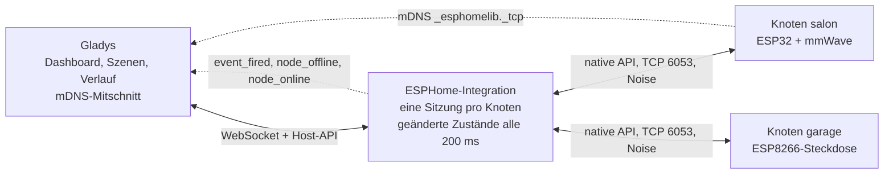
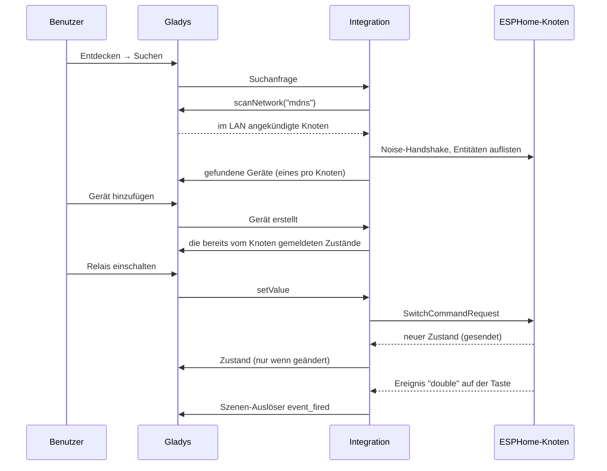
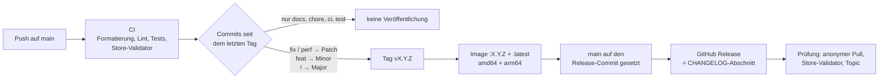

[English](README.md) · [Français](README.fr.md) · **Deutsch** · [Español](README.es.md)

# gladys-esphome

[](LICENSE)
[](https://github.com/William-De71/gladys-esphome/releases)
[](https://github.com/William-De71/gladys-esphome/actions/workflows/release.yml)
[](https://gladysassistant.com)


Externe [Gladys Assistant](https://gladysassistant.com)-Integration für **ESPHome**-Geräte (ESP32 / ESP8266) über die lokale native API. Mit einem Klick aus dem Store installiert, spricht sie direkt in Ihrem lokalen Netzwerk mit Ihren Knoten (Port 6053, Noise-Verschlüsselung): keine Cloud, kein MQTT-Broker, kein Home Assistant. Die Knoten werden per mDNS gefunden, ihre Entitäten werden von selbst zu Gladys-Funktionen, und jede Zustandsänderung erreicht Gladys in dem Moment, in dem sie geschieht.

📖 Benutzerdokumentation: [English](docs/en.md) — [Français](docs/fr.md) — [Deutsch](docs/de.md) — [Español](docs/es.md)

## Funktionen

- **Automatische Suche**: Gladys schneidet die mDNS-Ankündigungen der Knoten mit; nichts einzugeben, auch wenn sich eine DHCP-Zuweisung ändert.
- **Alle gängigen Entitäten**: Sensoren, Binärsensoren, Schalter, Lampen, Rollläden, Ventilatoren, Schlösser, Sirenen, Ventile, Taster, Zahlenwerte, Texte und Thermostate (Tabelle unten).
- **Echtzeit**: Die Knoten senden ihre Änderungen über eine offen gehaltene Sitzung; nur die geänderten Werte werden an Gladys übermittelt.
- **Szenen**: Starten Sie eine Szene, wenn ein ESPHome-`event` auslöst (ein Doppelklick, eine Türklingel) oder wenn ein Knoten offline geht, und führen Sie aus einer Szene die in der YAML eines Knotens angegebenen Aktionen (`api: actions:`) aus.
- **Robust**: Ein Knoten, der beim Start von Gladys ausgeschaltet war oder den die Suche übersehen hat, wird von selbst neu verbunden; die API-Slots jedes Knotens werden geschont.
- **Vier Sprachen**: Englisch, Französisch, Deutsch und Spanisch, in Gladys und in der Dokumentation.

## Funktionsweise




Von der Suche zu einem Zustand, einem Befehl und einer Szene:



## Unterstützte Entitäten

| ESPHome-Entität | Unterstützung in Gladys                                                                          |
| --------------- | ------------------------------------------------------------------------------------------------ |
| `sensor`        | Numerischer Sensor, eingeordnet nach seiner `device_class` — oder seiner Form                    |
| `binary_sensor` | Binärsensor (Bewegung, Anwesenheit, Öffnung, Leck, Rauch…), nach `device_class`                  |
| `text_sensor`   | Textfunktion (nur lesend)                                                                        |
| `text`          | Beschreibbarer Text: eine Nachricht an einen Knoten (ein E-Paper- oder OLED-`display:`)          |
| `switch`        | Binärer Schalter                                                                                 |
| `light`         | Ein/aus, Helligkeit, Farbe, Farbtemperatur — soweit die Farbmodi es zulassen                     |
| `cover`         | Zustand (öffnen/schließen/stoppen) + Position; Vorhang oder Rollladen nach `device_class`        |
| `fan`           | Ein/aus + Geschwindigkeit, skaliert auf die von der Firmware angegebenen Stufen                  |
| `lock`          | Verriegeln / entriegeln; blockierte und laufende Zustände werden nicht als „entriegelt“ gemeldet |
| `siren`         | Ein / aus                                                                                        |
| `valve`         | Offen / geschlossen                                                                              |
| `button`        | Drücken                                                                                          |
| `number`        | Beschreibbarer Wert, begrenzt durch `min_value` / `max_value` der YAML                           |
| `climate`       | Solltemperatur (ein einzelner Sollwert) + aktuelle Temperatur                                    |
| `event`         | Keine Funktion: der Szenen-Auslöser „ESPHome-Ereignis“                                           |

Entitätstypen ohne Entsprechung in Gladys (`media_player`, `camera`, `select`, `date`, …) werden bei der Suche ausgelassen, statt auf etwas abgebildet zu werden, das nicht funktionieren könnte. Ein `energy`-Sensor in kWh oder Wh ist ein kumulativer Zählerstand: Gladys leitet daraus den Verbrauch und seine Kosten ab.

### Von der YAML zu Gladys


ESPHome hat keinen Gerätekatalog: Ein Knoten stellt bereit, was seine YAML angibt. Die Zuordnung richtet sich daher nach dem, was die Firmware meldet, in drei Durchgängen:

1. die **`device_class`** (das von ESPHome dokumentierte Vokabular von Home Assistant) — `temperature`, `power`, `motion`, `door`…;
2. bei einem Sensor ohne Angabe die **Form seiner Deklaration** — eine Einheit `°` ist ein Winkel, eine ganze Zahl ohne Einheit ein Zähler. So werden die Zielwinkel und Zähler der mmWave-Sensoren (`ld2410`, `ld2450`) typisiert, denen ESPHome nie eine Klasse gibt;
3. alles, was dann noch nicht erkannt ist, wird zu einem **allgemeinen Messwert**, angezeigt unter seinem eigenen Namen und seiner Einheit. Es wird nie verworfen.

Jedes Kategorie/Typ-Paar, das die Zuordnung erzeugen kann, wird durch einen Test gegen die Paare abgesichert, die das Gladys-Frontend kennt, sodass keine Funktion mit leerer Bezeichnung angezeigt wird.

## Konfiguration

| Feld                        | Standard | Verwendung                                                                                          |
| --------------------------- | -------- | --------------------------------------------------------------------------------------------------- |
| Verschlüsselungsschlüssel   | leer     | Der von Ihren Knoten geteilte `api: encryption: key:`; leer bei unverschlüsselten Knoten            |
| Schlüssel pro Knoten        | leer     | `knoten\|schlüssel`, einer pro Zeile, für die Knoten mit eigenem Schlüssel                          |
| Manuell hinzugefügte Knoten | leer     | `salon.local`, `192.168.1.42` oder `192.168.1.42:6053`, für einen Knoten, den die Suche nicht sieht |
| Dauer der Suche (s)         | 8        | Wie lange die mDNS-Suche lauscht (3 bis 30)                                                         |
| Verbindungs-Timeout (s)     | 10       | Wie lange auf einen Knoten gewartet wird, bevor aufgegeben wird (5 bis 60)                          |

Aktionen der Integrationsseite: **Verbindung testen** (eine vollständige Suche, mit der Zahl der Knoten und Funktionen) und **Knoten neu verbinden** (schließt jede Sitzung und öffnet sie neu, nach einem Neuflashen oder einer Schlüsseländerung).

## Transport

ESPHome ist ausschließlich lokal: Das Manifest gibt `"transports": ["local"]` an, und jedes Gerät trägt ein Transport-Abzeichen — **Lokal**, solange sein Knoten verbunden ist, **Nicht erreichbar**, solange er es nicht ist.

## Szenen

| Auslöser                     | Wann                                                                                    | Filter                       | Variablen                                   |
| ---------------------------- | --------------------------------------------------------------------------------------- | ---------------------------- | ------------------------------------------- |
| ESPHome-Ereignis             | Eine `event`-Entität löst aus (`single`, `double`, `long`…)                             | Knoten, Entität, Ereignistyp | `node`, `entity`, `entity_id`, `event_type` |
| ESPHome-Knoten offline       | Ein Knoten war eine Minute lang getrennt (ein Neustart oder ein OTA-Update zählt nicht) | Knoten                       | `node`, `address`                           |
| ESPHome-Knoten wieder online | Dieser Knoten ist wieder verbunden                                                      | Knoten                       | `node`, `address`, `offline_minutes`        |

| Aktion                   | Felder                                                         | Ausgaben         |
| ------------------------ | -------------------------------------------------------------- | ---------------- |
| ESPHome-Aktion ausführen | Knoten, Aktion, Argumente (ein JSON-Objekt, Variablen erlaubt) | `node`, `action` |

Eine Taste, die Einfach- und Doppelklick unterscheidet, dann eine Aktion, die Gladys aufrufen kann:

```yaml
event:
  - platform: template
    name: 'Button'
    id: button_event
    event_types: [single, double]

binary_sensor:
  - platform: gpio
    pin: GPIO0
    on_multi_click:
      - timing:
          [ON for at most 0.5s, OFF for at most 0.3s, ON for at most 0.5s, OFF for at least 0.2s]
        then:
          - event.trigger: { id: button_event, event_type: double }
      - timing: [ON for at most 0.5s, OFF for at least 0.4s]
        then:
          - event.trigger: { id: button_event, event_type: single }

api:
  actions:
    - action: play_rtttl
      variables:
        song_str: string
      then:
        - rtttl.play:
            rtttl: !lambda 'return song_str;'
```

In einer Szene: Auslöser **ESPHome-Ereignis** mit Knoten `salon`, Entität `Button`, Ereignistyp `double`; Aktion **ESPHome-Aktion ausführen** mit Knoten `salon`, Aktion `play_rtttl`, Argumente `{"song_str": "two_short:d=4,o=5,b=100:16e6,16e6"}`. Zwei Sekunden lang, nachdem die Integration eine Aktion auf einem Knoten ausgeführt hat, starten die Ereignisse dieses Knotens keine Szene: Eine Aktion, die ein Ereignis auslöst, kann nicht in einer Schleife auf die Szene zurückwirken, die sie aufgerufen hat.

## Installation

1. In Gladys (5.3.0 oder neuer): **Integrationen → Store**, nach **ESPHome** suchen, installieren.
2. Fügen Sie Ihren Verschlüsselungsschlüssel in die Konfiguration ein und speichern Sie.
3. **Entdecken → Suchen**, dann die gewünschten Knoten hinzufügen.

Die [Benutzerdokumentation](docs/de.md) erläutert die Schlüssel pro Knoten, die manuell hinzugefügten Knoten, die `device_class` und die Fehlerbehebung.

## Entwicklung

```bash
npm install
GLADYS_HOST_API_URL="http://localhost:1443" \
GLADYS_INTEGRATION_TOKEN="<token>" \
npm start
```

```
index.js                     SDK wiring only: createApp(new GladysIntegration()) + connect
src/
  app.js                     every handler (discovery, commands, scenes, device created)
  events.js                  scene triggers: event_fired, node_offline, node_online
  config.js                  config normalization, per-node keys, manual nodes
  devices.js                 discovery, state batching, commands
  messages.js                user-facing messages, in en / fr / de / es
  esphome/
    EsphomeManager.js        one live connection per node, entity index, last states
    actions.js               user-defined actions: typed arguments
    mapping.js               ESPHome entity -> Gladys feature descriptors
    convert.js               value translation, both directions
    constants.js             mDNS service, port, timings, external-id scheme
```

Die Plattform-Kennung ist der **Knotenname** von ESPHome, stabil über Neustarts und DHCP-Zuweisungen hinweg — eine IP-Adresse ist es nicht, deshalb liegt sie stattdessen in einem Geräteparameter:

```
device : ext:<selector>:esphome:<nodeName>
feature: ext:<selector>:esphome:<nodeName>:<entityType>-<objectId>:<featureKey>
```

**Push statt Poll.** Die Zustände erreichen Gladys über die Sitzung des Knotens, und keine Funktion gibt eine `poll_frequency` an. Ein Watchdog versucht jede Minute erneut, die bekannten Knoten ohne aktive Sitzung zu verbinden.

**Fehlend heißt Standardwert.** protobuf 3 serialisiert nie ein Feld, das seinen Standardwert enthält: Ein ausgeschalteter Schalter, eine Steckdose mit 0 W oder ein geschlossener Rollladen kommen ohne dieses Feld an. Jedes Ereignis wird anhand des Entitätsschemas vervollständigt, bevor es gelesen wird.

**Ein Knoten hat vier API-Slots.** Verbindungsversuche zu einem Knoten werden geteilt, Wiederholungen beim Aufbau sind auf eine begrenzt, ein von der Suche gefundener _und_ manuell angegebener Knoten behält eine einzige Sitzung, und jede Sitzung wird beim Herunterfahren sauber geschlossen.

**Zustände werden gebündelt, dann dedupliziert.** Die Zustände werden 200 ms lang gesammelt und mit `publishChangedStates` veröffentlicht: Ein unveränderter Messwert wird verworfen (einmal pro Stunde erneut gesendet), ein binärer Zustand behält jedoch seine Übergänge 0 → 1 → 0, sodass eine Bewegung, die kürzer als das Zeitfenster ist, trotzdem eine Szene auslöst.

## Tests

```bash
npm test               # node --test, never touches the network
npm run lint           # ESLint
npm run format:check   # Prettier, as the CI runs it
npx github:GladysAssistant/integration-store . --skip-image-check
```

`test/structure.test.js` vergleicht die Suche mit `test/fixtures/discovery.baseline.json`, erzeugt aus v1.1.0 mit einem Knoten, der jede Entitätsform bereitstellt: Eine externe Kennung, eine Kategorie, ein Typ, eine Einheit oder eine Grenze, die sich ändert, würde die Benutzer zwingen, ihre Geräte neu anzulegen. `test/app.test.js` steuert die Handler mit dem Fake-Gladys des SDK.

## Veröffentlichung

Veröffentlichungen erfolgen automatisch. Jeder Push auf `main` startet die CI und berechnet dann die nächste Version aus den Conventional Commits seit dem letzten Tag:



Das Manifest erreicht `main` erst, wenn sein Image existiert, sodass der Store nie eine Version ankündigt, die er nicht herunterladen kann. `CHANGELOG.md` wird erzeugt: Bearbeiten Sie die Datei nie von Hand. **Actions → Release → Run workflow** bietet `release-as` (eine Version erzwingen) und `dry-run` (Version und Notizen anzeigen, ohne zu veröffentlichen).

Titel von Commits und Pull Requests folgen [Conventional Commits](https://www.conventionalcommits.org/), auf Englisch, formuliert als die Changelog-Zeile, die der Benutzer lesen wird: `feat(scenes): start a scene when an ESPHome node goes offline`.

## Fehlerbehebung

| Symptom                                                 | Wahrscheinliche Ursache                                                                                       |
| ------------------------------------------------------- | ------------------------------------------------------------------------------------------------------------- |
| Kein Knoten gefunden                                    | mDNS blockiert (VLAN, Client-Isolation): Knoten manuell hinzufügen                                            |
| Knoten im Netzwerk sichtbar, aber nicht in der Liste    | Verschlüsselungsschlüssel passt nicht: `api: encryption: key:` prüfen oder **Schlüssel pro Knoten** verwenden |
| Gerät „Nicht erreichbar“                                | Knoten aus, außer WLAN-Reichweite oder seine vier API-Slots belegt (Home Assistant, eine offene Log-Konsole)  |
| Ein Sensor unter „Unbekannt“                            | Keine `device_class` in der YAML: eine ergänzen und erneut suchen                                             |
| Die Szenen-Aktion schlägt mit „declares no action“ fehl | Aktionsname weicht von `action:` in der YAML ab; der Fehler listet die Aktionen auf, die der Knoten angibt    |

Protokolle: der Tab **Überwachung** der Integration; fügen Sie dem Container `DEBUG=gladys-integration-sdk` hinzu, um die Details des SDK zu sehen.

## Mitwirken

Issues und Pull Requests sind willkommen: [Fehlerbericht](https://github.com/William-De71/gladys-esphome/issues/new?template=bug_report.yml) (Versionen von Gladys, der Integration und ESPHome, die YAML der Entität, Protokolle) oder [Funktionswunsch](https://github.com/William-De71/gladys-esphome/issues/new?template=feature_request.yml). Rückmeldungen und Fragen gehören auch in den [Forum-Thread](https://community.gladysassistant.com/t/8494). Sicherheitsprobleme: siehe [SECURITY.md](SECURITY.md).

Spricht die native ESPHome-API über [`esphome-client`](https://github.com/hjdhjd/esphome-client), eine Implementierung ohne Abhängigkeiten einschließlich des Noise-Handshakes. Aufgebaut auf dem [Gladys-Integrations-SDK](https://github.com/GladysAssistant/integration-sdk-js), ausgehend von der [offiziellen Vorlage](https://github.com/GladysAssistant/integration-template-js).

## Lizenz

[Apache-2.0](LICENSE) — siehe auch [NOTICE](NOTICE). ESPHome ist eine Marke der Open Home Foundation; dieses Projekt ist nicht mit ihr verbunden.
