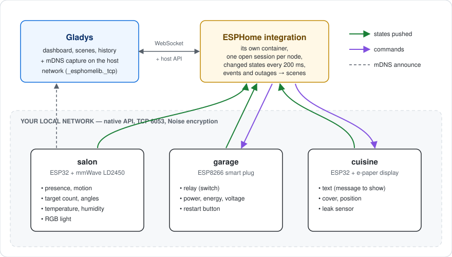
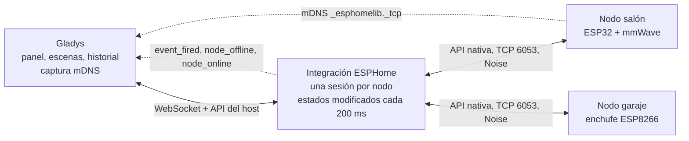
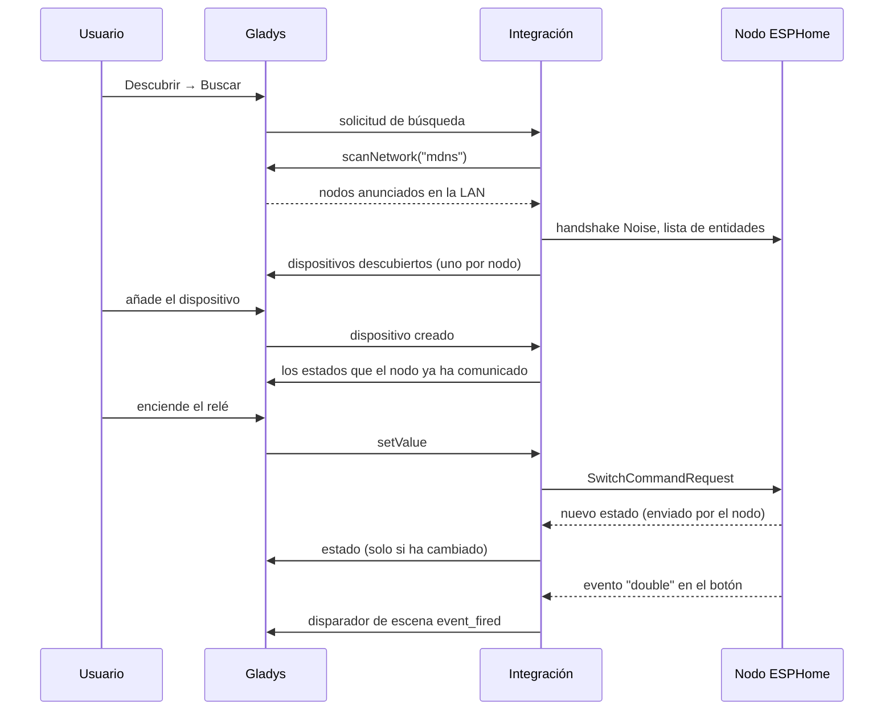
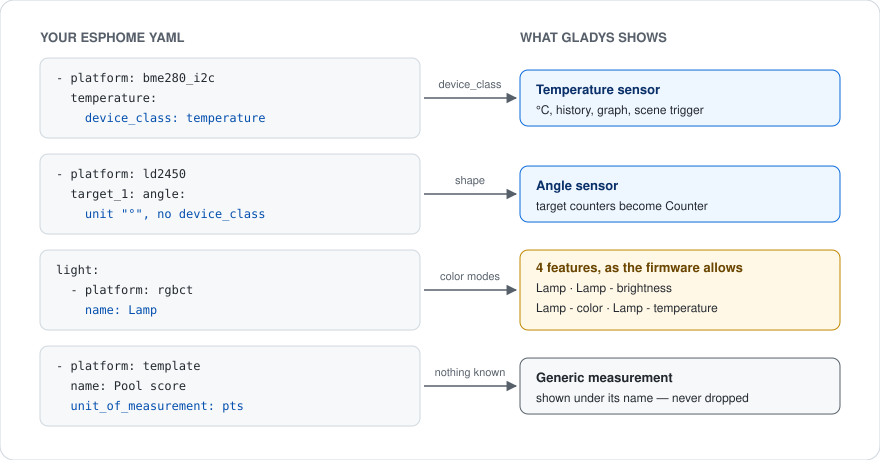
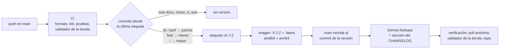

[English](README.md) · [Français](README.fr.md) · [Deutsch](README.de.md) · **Español**

# gladys-esphome

[](LICENSE)
[](https://github.com/William-De71/gladys-esphome/releases)
[](https://github.com/William-De71/gladys-esphome/actions/workflows/release.yml)
[](https://gladysassistant.com)


Integración externa de [Gladys Assistant](https://gladysassistant.com) para los dispositivos **ESPHome** (ESP32 / ESP8266), mediante la API nativa local. Se instala desde la tienda con un solo clic y se comunica directamente con sus nodos en su red local (puerto 6053, cifrado Noise): sin nube, sin broker MQTT y sin Home Assistant. Los nodos se encuentran por mDNS, sus entidades se convierten por sí solas en funcionalidades de Gladys, y cada cambio de estado llega a Gladys en el mismo instante en que se produce.

📖 Documentación de usuario: [English](docs/en.md) — [Français](docs/fr.md) — [Deutsch](docs/de.md) — [Español](docs/es.md)

## Funcionalidades

- **Descubrimiento automático**: Gladys capta los anuncios mDNS de los nodos; no hay nada que escribir, ni siquiera cuando cambia una concesión DHCP.
- **Todas las entidades habituales**: sensores, sensores binarios, interruptores, luces, persianas, ventiladores, cerraduras, sirenas, válvulas, botones, números, textos y termostatos (tabla más abajo).
- **Tiempo real**: los nodos envían sus cambios por una sesión que se mantiene abierta; a Gladys solo se envían los valores que han cambiado.
- **Escenas**: inicie una escena cuando se activa un `event` de ESPHome (un doble clic, un timbre) o cuando un nodo se desconecta, y ejecute desde una escena las acciones declaradas en el YAML de un nodo (`api: actions:`).
- **Resistente**: un nodo que estaba apagado al arrancar Gladys, o que la búsqueda no detectó, se reconecta por sí solo; se preservan las ranuras API de cada nodo.
- **Cuatro idiomas**: inglés, francés, alemán y español, en Gladys y en la documentación.

## Cómo funciona





De la búsqueda a un estado, un comando y una escena:



## Entidades compatibles

| Entidad ESPHome | Compatibilidad en Gladys                                                                       |
| --------------- | ---------------------------------------------------------------------------------------------- |
| `sensor`        | Sensor numérico, clasificado por su `device_class` o por su forma                              |
| `binary_sensor` | Sensor binario (movimiento, presencia, apertura, fuga, humo…), por `device_class`              |
| `text_sensor`   | Funcionalidad de texto (solo lectura)                                                          |
| `text`          | Texto editable: enviar un mensaje a un nodo (una pantalla `display:` e-paper u OLED)           |
| `switch`        | Interruptor binario                                                                            |
| `light`         | Encendido/apagado, brillo, color, temperatura de color, según los modos de color               |
| `cover`         | Estado (abrir/cerrar/detener) + posición; cortina o persiana según `device_class`              |
| `fan`           | Encendido/apagado + velocidad, escalada según los niveles que declara el firmware              |
| `lock`          | Bloquear / desbloquear; los estados atascado y en movimiento no se indican como «desbloqueado» |
| `siren`         | Encendida / apagada                                                                            |
| `valve`         | Abierta / cerrada                                                                              |
| `button`        | Pulsar                                                                                         |
| `number`        | Valor editable limitado por `min_value` / `max_value` del YAML                                 |
| `climate`       | Temperatura de consigna (una sola) + temperatura actual                                        |
| `event`         | Ninguna funcionalidad: el disparador de escena «Evento de ESPHome»                             |

Los tipos de entidad sin equivalente en Gladys (`media_player`, `camera`, `select`, `date`, …) se omiten en el descubrimiento en lugar de asociarse a algo que no podría funcionar. Un sensor `energy` en kWh o Wh es un índice acumulado: Gladys calcula a partir de él el consumo y su coste.

### Del YAML a Gladys



ESPHome no tiene catálogo de dispositivos: un nodo expone lo que declara su YAML. Por eso la correspondencia se basa en lo que comunica el firmware, en tres pasadas:

1. el **`device_class`** (el vocabulario de Home Assistant que documenta ESPHome): `temperature`, `power`, `motion`, `door`…;
2. para un sensor que no declara ninguno, la **forma de su declaración**: una unidad `°` es un ángulo, un número entero sin unidad es un contador. Así se tipan los ángulos y contadores de objetivos de los sensores mmWave (`ld2410`, `ld2450`), a los que ESPHome nunca asigna una clase;
3. lo que siga sin identificarse se convierte en una **medida genérica**, mostrada con su propio nombre y unidad. Nunca se descarta.

Cada par categoría/tipo que puede generar la correspondencia está fijado por una prueba frente a los pares que conoce el front de Gladys, de modo que ninguna funcionalidad se muestra con una etiqueta vacía.

## Configuración

| Campo                            | Por defecto | Uso                                                                                     |
| -------------------------------- | ----------- | --------------------------------------------------------------------------------------- |
| Clave de cifrado                 | vacío       | La `api: encryption: key:` que comparten sus nodos; vacía para los nodos sin cifrado    |
| Claves por nodo                  | vacío       | `nodo\|clave`, una por línea, para los nodos que tienen su propia clave                 |
| Nodos añadidos a mano            | vacío       | `salon.local`, `192.168.1.42` o `192.168.1.42:6053`, para un nodo que la búsqueda no ve |
| Duración de la búsqueda (s)      | 8           | Tiempo durante el cual escucha la búsqueda mDNS (de 3 a 30)                             |
| Tiempo de espera de conexión (s) | 10          | Tiempo de espera de un nodo antes de abandonarlo (de 5 a 60)                            |

Acciones de la página de la integración: **Probar la conexión** (un descubrimiento completo, con el número de nodos y de funcionalidades) y **Reconectar los nodos** (cierra y vuelve a abrir todas las sesiones, tras reprogramar un nodo o cambiar una clave).

## Transporte

ESPHome es exclusivamente local: el manifiesto declara `"transports": ["local"]`, y cada dispositivo lleva una insignia de transporte: **Local** mientras su nodo está conectado, **Inaccesible** mientras no lo está.

## Escenas

| Disparador                      | Cuándo                                                                                                 | Filtros                       | Variables                                   |
| ------------------------------- | ------------------------------------------------------------------------------------------------------ | ----------------------------- | ------------------------------------------- |
| Evento de ESPHome               | Se activa una entidad `event` (`single`, `double`, `long`…)                                            | nodo, entidad, tipo de evento | `node`, `entity`, `entity_id`, `event_type` |
| Nodo ESPHome desconectado       | Un nodo ha permanecido desconectado durante un minuto (un reinicio o una actualización OTA no cuentan) | nodo                          | `node`, `address`                           |
| Nodo ESPHome conectado de nuevo | Ese nodo vuelve a estar conectado                                                                      | nodo                          | `node`, `address`, `offline_minutes`        |

| Acción                         | Campos                                                          | Salidas          |
| ------------------------------ | --------------------------------------------------------------- | ---------------- |
| Ejecutar una acción de ESPHome | nodo, acción, argumentos (un objeto JSON, se admiten variables) | `node`, `action` |

Un botón que distingue los clics simples y dobles, y después una acción que Gladys puede llamar:

```yaml
event:
  - platform: template
    name: 'Button'
    id: button_event
    event_types: [single, double]

binary_sensor:
  - platform: gpio
    pin: GPIO0
    on_multi_click:
      - timing:
          [ON for at most 0.5s, OFF for at most 0.3s, ON for at most 0.5s, OFF for at least 0.2s]
        then:
          - event.trigger: { id: button_event, event_type: double }
      - timing: [ON for at most 0.5s, OFF for at least 0.4s]
        then:
          - event.trigger: { id: button_event, event_type: single }

api:
  actions:
    - action: play_rtttl
      variables:
        song_str: string
      then:
        - rtttl.play:
            rtttl: !lambda 'return song_str;'
```

En una escena: disparador **Evento de ESPHome** con el nodo `salon`, la entidad `Button` y el tipo de evento `double`; acción **Ejecutar una acción de ESPHome** con el nodo `salon`, la acción `play_rtttl` y los argumentos `{"song_str": "two_short:d=4,o=5,b=100:16e6,16e6"}`. Durante los dos segundos siguientes a la ejecución de una acción en un nodo por parte de la integración, los eventos de ese nodo no inician escenas: una acción que activa un evento no puede entrar en bucle con la escena que la llamó.

## Instalación

1. En Gladys (5.1.0 o posterior): **Integraciones → Tienda**, busque **ESPHome** e instálela.
2. Pegue su clave de cifrado en la configuración y guarde.
3. **Descubrir → Buscar**, y añada los nodos que desee.

La [documentación de usuario](docs/es.md) detalla las claves por nodo, los nodos añadidos a mano, el `device_class` y la solución de problemas.

## Desarrollo

```bash
npm install
GLADYS_HOST_API_URL="http://localhost:1443" \
GLADYS_INTEGRATION_TOKEN="<token>" \
npm start
```

```
index.js                     SDK wiring only: createApp(new GladysIntegration()) + connect
src/
  app.js                     every handler (discovery, commands, scenes, device created)
  events.js                  scene triggers: event_fired, node_offline, node_online
  config.js                  config normalization, per-node keys, manual nodes
  devices.js                 discovery, state batching, commands
  messages.js                user-facing messages, in en / fr / de / es
  esphome/
    EsphomeManager.js        one live connection per node, entity index, last states
    actions.js               user-defined actions: typed arguments
    mapping.js               ESPHome entity -> Gladys feature descriptors
    convert.js               value translation, both directions
    constants.js             mDNS service, port, timings, external-id scheme
```

El identificador de plataforma es el **nombre del nodo** ESPHome, estable a través de los reinicios y de las concesiones DHCP; una dirección IP no lo es, por lo que se guarda en un parámetro del dispositivo:

```
device : ext:<selector>:esphome:<nodeName>
feature: ext:<selector>:esphome:<nodeName>:<entityType>-<objectId>:<featureKey>
```

**Push, no polling.** Los estados llegan a Gladys desde la sesión del nodo, y ninguna funcionalidad declara un `poll_frequency`. Un watchdog reintenta cada minuto la conexión con los nodos conocidos que no tienen una sesión activa.

**Ausente significa por defecto.** protobuf 3 nunca serializa un campo que contiene su valor por defecto: un interruptor apagado, un enchufe que consume 0 W o una persiana cerrada llegan sin ese campo. Cada evento se completa a partir del esquema de la entidad antes de leerse.

**Un nodo tiene cuatro ranuras API.** Los intentos de conexión a un mismo nodo se comparten, los reintentos de construcción se limitan a uno, un nodo encontrado por la búsqueda _y_ declarado a mano conserva una sola sesión, y cada sesión se cierra ordenadamente al apagar.

**Los estados se agrupan y luego se deduplican.** Los estados se recogen durante 200 ms y se publican con `publishChangedStates`: una lectura que no ha cambiado se descarta (se reenvía una vez por hora), pero un estado binario conserva sus transiciones 0 → 1 → 0, de modo que un movimiento más corto que la ventana sigue activando una escena.

## Pruebas

```bash
npm test               # node --test, never touches the network
npm run lint           # ESLint
npm run format:check   # Prettier, as the CI runs it
npx github:GladysAssistant/integration-store . --skip-image-check
```

`test/structure.test.js` compara el descubrimiento con `test/fixtures/discovery.baseline.json`, generado a partir de la v1.1.0 con un nodo que expone todas las formas de entidad: un identificador externo, una categoría, un tipo, una unidad o un límite que cambiara obligaría a los usuarios a volver a crear sus dispositivos. `test/app.test.js` controla los handlers con el Gladys simulado del SDK.

## Publicación

Las versiones se publican automáticamente. Cada push en `main` ejecuta la CI y después calcula la siguiente versión a partir de los Conventional Commits desde la última etiqueta:



El manifiesto solo llega a `main` una vez que existe su imagen, de modo que la tienda nunca anuncia una versión que no puede descargar. `CHANGELOG.md` se genera automáticamente: no lo edite nunca a mano. **Actions → Release → Run workflow** ofrece `release-as` (forzar una versión) y `dry-run` (mostrar la versión y las notas sin publicar).

Los títulos de los commits y de las pull requests siguen [Conventional Commits](https://www.conventionalcommits.org/), en inglés, redactados como la línea del changelog que leerá el usuario: `feat(scenes): start a scene when an ESPHome node goes offline`.

## Solución de problemas

| Síntoma                                            | Causa probable                                                                                                                  |
| -------------------------------------------------- | ------------------------------------------------------------------------------------------------------------------------------- |
| No se encuentra ningún nodo                        | mDNS bloqueado (VLAN, aislamiento de clientes): añada el nodo a mano                                                            |
| Nodo visible en la red pero ausente de la lista    | La clave de cifrado no coincide: compruebe `api: encryption: key:`, o utilice **Claves por nodo**                               |
| Dispositivo «Inaccesible»                          | Nodo apagado, fuera del alcance del Wi-Fi, o sus cuatro ranuras API ocupadas (Home Assistant, una consola de registros abierta) |
| Un sensor en «Desconocido»                         | Sin `device_class` en el YAML: añada uno y vuelva a buscar                                                                      |
| La acción de escena falla con «declares no action» | Nombre de acción distinto del `action:` del YAML; el error enumera las acciones que declara el nodo                             |

Registros: la pestaña **Supervisión** de la integración; añada `DEBUG=gladys-integration-sdk` al contenedor para ver los detalles del SDK.

## Contribuir

Las issues y pull requests son bienvenidas: [informe de error](https://github.com/William-De71/gladys-esphome/issues/new?template=bug_report.yml) (versiones de Gladys, de la integración y de ESPHome, el YAML de la entidad, registros) o [solicitud de funcionalidad](https://github.com/William-De71/gladys-esphome/issues/new?template=feature_request.yml). Los comentarios y preguntas también tienen cabida en el [hilo del foro](https://community.gladysassistant.com/t/8494). Problemas de seguridad: consulte [SECURITY.md](SECURITY.md).

Habla la API nativa de ESPHome mediante [`esphome-client`](https://github.com/hjdhjd/esphome-client), una implementación sin dependencias que incluye el handshake Noise. Construida sobre el [SDK de integraciones de Gladys](https://github.com/GladysAssistant/integration-sdk-js), a partir de la [plantilla oficial](https://github.com/GladysAssistant/integration-template-js).

## Licencia

[Apache-2.0](LICENSE): consulte también [NOTICE](NOTICE). ESPHome es una marca de la Open Home Foundation; este proyecto no está afiliado a ella.
