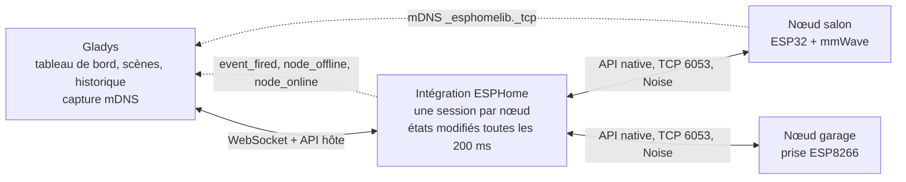
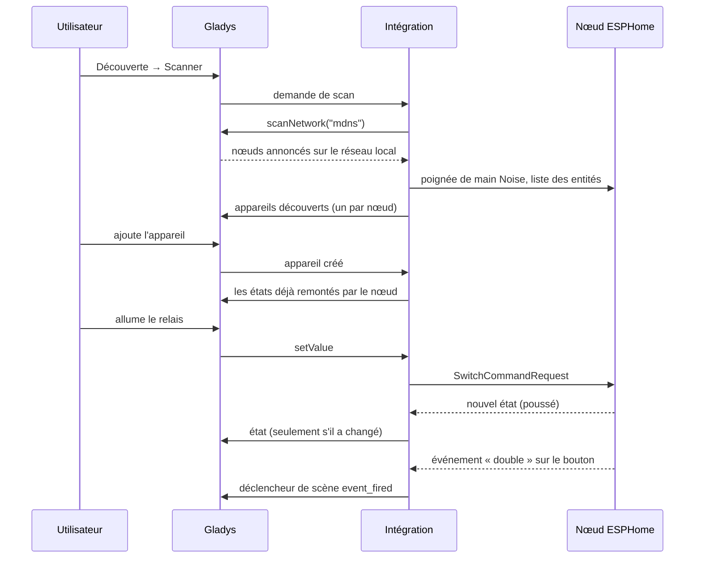
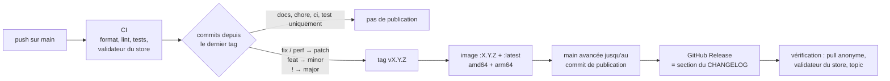

[English](README.md) · **Français** · [Deutsch](README.de.md) · [Español](README.es.md)

# gladys-esphome

[](LICENSE)
[](https://github.com/William-De71/gladys-esphome/releases)
[](https://github.com/William-De71/gladys-esphome/actions/workflows/release.yml)
[](https://gladysassistant.com)


Intégration externe [Gladys Assistant](https://gladysassistant.com) pour les appareils **ESPHome** (ESP32 / ESP8266), via l'API native locale. Installée depuis le store en un clic, elle dialogue directement avec vos nœuds sur votre réseau local (port 6053, chiffrement Noise) : pas de cloud, pas de broker MQTT, pas de Home Assistant. Les nœuds sont trouvés par mDNS, leurs entités deviennent d'elles-mêmes des fonctionnalités Gladys, et chaque changement d'état parvient à Gladys à l'instant où il se produit.

📖 Documentation utilisateur : [English](docs/en.md) — [Français](docs/fr.md) — [Deutsch](docs/de.md) — [Español](docs/es.md)

## Fonctionnalités

- **Découverte automatique** : Gladys capte les annonces mDNS des nœuds ; rien à saisir, même quand un bail DHCP change.
- **Toutes les entités courantes** : capteurs, capteurs binaires, interrupteurs, lampes, volets, ventilateurs, serrures, sirènes, vannes, boutons, nombres, textes et thermostats (tableau ci-dessous).
- **Temps réel** : les nœuds poussent leurs changements sur une session maintenue ouverte ; seules les valeurs qui ont changé sont envoyées à Gladys.
- **Scènes** : démarrez une scène quand un `event` ESPHome se déclenche (un double clic, une sonnette) ou quand un nœud passe hors ligne, et exécutez depuis une scène les actions déclarées dans le YAML d'un nœud (`api: actions:`).
- **Résiliente** : un nœud éteint au démarrage de Gladys, ou manqué par le scan, est reconnecté de lui-même ; les emplacements API de chaque nœud sont ménagés.
- **Quatre langues** : anglais, français, allemand et espagnol, dans Gladys comme dans la documentation.

## Fonctionnement




Du scan à un état, une commande et une scène :



## Entités prises en charge

| Entité ESPHome  | Prise en charge dans Gladys                                                                         |
| --------------- | --------------------------------------------------------------------------------------------------- |
| `sensor`        | Capteur numérique, classé selon son `device_class` — ou selon sa forme                              |
| `binary_sensor` | Capteur binaire (mouvement, présence, ouverture, fuite, fumée…), selon `device_class`               |
| `text_sensor`   | Fonctionnalité texte (lecture seule)                                                                |
| `text`          | Texte modifiable : envoyer un message à un nœud (un `display:` e-paper ou OLED)                     |
| `switch`        | Interrupteur binaire                                                                                |
| `light`         | Marche/arrêt, luminosité, couleur, température de couleur — selon les modes de couleur              |
| `cover`         | État (ouvrir/fermer/arrêter) + position ; rideau ou volet selon `device_class`                      |
| `fan`           | Marche/arrêt + vitesse, mise à l'échelle des niveaux déclarés par le firmware                       |
| `lock`          | Verrouiller / déverrouiller ; les états bloqué et en mouvement ne passent pas pour « déverrouillé » |
| `siren`         | Marche / arrêt                                                                                      |
| `valve`         | Ouverte / fermée                                                                                    |
| `button`        | Appui                                                                                               |
| `number`        | Valeur modifiable bornée par les `min_value` / `max_value` du YAML                                  |
| `climate`       | Température de consigne (une seule) + température mesurée                                           |
| `event`         | Aucune fonctionnalité : le déclencheur de scène « Événement ESPHome »                               |

Les types d'entités sans équivalent dans Gladys (`media_player`, `camera`, `select`, `date`, …) sont écartés de la découverte plutôt que convertis en quelque chose qui ne pourrait pas fonctionner. Un capteur `energy` en kWh ou en Wh est un index cumulé : Gladys en déduit la consommation et son coût.

### Du YAML à Gladys


ESPHome n'a pas de catalogue d'appareils : un nœud expose ce que déclare son YAML. La correspondance s'appuie donc sur ce que remonte le firmware, en trois passes :

1. le **`device_class`** (le vocabulaire Home Assistant documenté par ESPHome) — `temperature`, `power`, `motion`, `door`… ;
2. pour un capteur qui n'en déclare aucun, la **forme de sa déclaration** — une unité `°` est un angle, un nombre entier sans unité un compteur. C'est ce qui type les angles de cible et les compteurs des capteurs mmWave (`ld2410`, `ld2450`), auxquels ESPHome ne donne jamais de classe ;
3. tout ce qui reste non identifié devient une **mesure générique**, affichée sous son propre nom et avec sa propre unité. Rien n'est jamais abandonné.

Chaque couple catégorie/type que la correspondance peut produire est vérifié par un test contre les couples connus du front de Gladys, si bien qu'aucune fonctionnalité ne s'affiche avec un libellé vide.

## Configuration

| Champ                            | Défaut | Usage                                                                                      |
| -------------------------------- | ------ | ------------------------------------------------------------------------------------------ |
| Clé de chiffrement               | vide   | La `api: encryption: key:` partagée par vos nœuds ; vide pour des nœuds non chiffrés       |
| Clés par nœud                    | vide   | `nœud\|clé`, une par ligne, pour les nœuds qui ont leur propre clé                         |
| Nœuds ajoutés à la main          | vide   | `salon.local`, `192.168.1.42` ou `192.168.1.42:6053`, pour un nœud que le scan ne voit pas |
| Durée de la découverte (s)       | 8      | Durée d'écoute du scan mDNS (3 à 30)                                                       |
| Délai d'attente de connexion (s) | 10     | Temps d'attente d'un nœud avant de l'abandonner (5 à 60)                                   |

Actions de la page de l'intégration : **Tester la connexion** (une découverte complète, avec le nombre de nœuds et de fonctionnalités) et **Reconnecter les nœuds** (ferme puis rouvre toutes les sessions, après un reflash ou un changement de clé).

## Transport

ESPHome est uniquement local : le manifeste déclare `"transports": ["local"]`, et chaque appareil porte un macaron de transport — **Local** tant que son nœud est connecté, **Injoignable** sinon.

## Scènes

| Déclencheur                     | Quand                                                                                                   | Filtres                        | Variables                                   |
| ------------------------------- | ------------------------------------------------------------------------------------------------------- | ------------------------------ | ------------------------------------------- |
| Événement ESPHome               | Une entité `event` se déclenche (`single`, `double`, `long`…)                                           | nœud, entité, type d'événement | `node`, `entity`, `entity_id`, `event_type` |
| Nœud ESPHome hors ligne         | Un nœud est resté déconnecté pendant une minute (un redémarrage ou une mise à jour OTA ne comptent pas) | nœud                           | `node`, `address`                           |
| Nœud ESPHome de retour en ligne | Ce nœud est de nouveau connecté                                                                         | nœud                           | `node`, `address`, `offline_minutes`        |

| Action                      | Champs                                                       | Sorties          |
| --------------------------- | ------------------------------------------------------------ | ---------------- |
| Exécuter une action ESPHome | nœud, action, arguments (un objet JSON, variables acceptées) | `node`, `action` |

Un bouton qui distingue simple et double clic, puis une action que Gladys peut appeler :

```yaml
event:
  - platform: template
    name: 'Button'
    id: button_event
    event_types: [single, double]

binary_sensor:
  - platform: gpio
    pin: GPIO0
    on_multi_click:
      - timing:
          [ON for at most 0.5s, OFF for at most 0.3s, ON for at most 0.5s, OFF for at least 0.2s]
        then:
          - event.trigger: { id: button_event, event_type: double }
      - timing: [ON for at most 0.5s, OFF for at least 0.4s]
        then:
          - event.trigger: { id: button_event, event_type: single }

api:
  actions:
    - action: play_rtttl
      variables:
        song_str: string
      then:
        - rtttl.play:
            rtttl: !lambda 'return song_str;'
```

Dans une scène : déclencheur **Événement ESPHome** avec le nœud `salon`, l'entité `Button`, le type d'événement `double` ; action **Exécuter une action ESPHome** avec le nœud `salon`, l'action `play_rtttl`, les arguments `{"song_str": "two_short:d=4,o=5,b=100:16e6,16e6"}`. Pendant les deux secondes qui suivent l'exécution d'une action sur un nœud par l'intégration, les événements de ce nœud ne démarrent aucune scène : une action qui déclenche un événement ne peut pas boucler sur la scène qui l'a appelée.

## Installation

1. Dans Gladys (5.1.0 ou plus récent) : **Intégrations**, cherchez **ESPHome** dans le store, installez-la.
2. Collez votre clé de chiffrement dans la configuration, enregistrez.
3. **Découverte → Scanner**, puis ajoutez les nœuds de votre choix.

La [documentation utilisateur](docs/fr.md) détaille les clés par nœud, les nœuds ajoutés à la main, le `device_class` et la résolution de problèmes.

## Développement

```bash
npm install
GLADYS_HOST_API_URL="http://localhost:1443" \
GLADYS_INTEGRATION_TOKEN="<token>" \
npm start
```

```
index.js                     SDK wiring only: createApp(new GladysIntegration()) + connect
src/
  app.js                     every handler (discovery, commands, scenes, device created)
  events.js                  scene triggers: event_fired, node_offline, node_online
  config.js                  config normalization, per-node keys, manual nodes
  devices.js                 discovery, state batching, commands
  messages.js                user-facing messages, in en / fr / de / es
  esphome/
    EsphomeManager.js        one live connection per node, entity index, last states
    actions.js               user-defined actions: typed arguments
    mapping.js               ESPHome entity -> Gladys feature descriptors
    convert.js               value translation, both directions
    constants.js             mDNS service, port, timings, external-id scheme
```

L'identifiant de plateforme est le **nom du nœud** ESPHome, stable à travers les redémarrages et les baux DHCP — une adresse IP ne l'est pas, elle est donc rangée dans un paramètre de l'appareil :

```
device : ext:<selector>:esphome:<nodeName>
feature: ext:<selector>:esphome:<nodeName>:<entityType>-<objectId>:<featureKey>
```

**Push, pas de poll.** Les états parviennent à Gladys par la session du nœud, et aucune fonctionnalité ne déclare de `poll_frequency`. Un chien de garde retente, toutes les minutes, les nœuds connus qui n'ont pas de session active.

**Absent signifie défaut.** protobuf 3 ne sérialise jamais un champ qui porte sa valeur par défaut : un interrupteur éteint, une prise qui consomme 0 W ou un volet fermé arrivent sans ce champ. Chaque événement est complété à partir du schéma de l'entité avant d'être lu.

**Un nœud a quatre emplacements API.** Les tentatives de connexion à un même nœud sont mutualisées, les relances de construction sont plafonnées à une, un nœud trouvé par le scan _et_ déclaré à la main garde une seule session, et chaque session est fermée proprement à l'arrêt.

**Les états sont regroupés, puis dédoublonnés.** Les états sont collectés pendant 200 ms puis publiés avec `publishChangedStates` : une mesure inchangée est écartée (renvoyée une fois par heure), mais un état binaire conserve ses transitions 0 → 1 → 0, si bien qu'un mouvement plus court que la fenêtre déclenche quand même une scène.

## Tests

```bash
npm test               # node --test, never touches the network
npm run lint           # ESLint
npm run format:check   # Prettier, as the CI runs it
npx github:GladysAssistant/integration-store . --skip-image-check
```

`test/structure.test.js` compare la découverte à `test/fixtures/discovery.baseline.json`, généré depuis la v1.1.0 avec un nœud exposant toutes les formes d'entités : un identifiant externe, une catégorie, un type, une unité ou une borne qui change obligerait les utilisateurs à recréer leurs appareils. `test/app.test.js` pilote les handlers avec le faux Gladys du SDK.

## Publication

Les publications sont automatiques. Chaque push sur `main` lance la CI, puis calcule la version suivante à partir des Conventional Commits depuis le dernier tag :



Le manifeste n'arrive sur `main` qu'une fois son image disponible, si bien que le store n'annonce jamais une version qu'il ne peut pas télécharger. `CHANGELOG.md` est généré : ne le modifiez jamais à la main. **Actions → Release → Run workflow** propose `release-as` (forcer une version) et `dry-run` (afficher la version et les notes sans publier).

Les titres de commit et de pull request suivent les [Conventional Commits](https://www.conventionalcommits.org/), en anglais, rédigés comme la ligne du changelog que l'utilisateur lira : `feat(scenes): start a scene when an ESPHome node goes offline`.

## Résolution de problèmes

| Symptôme                                             | Cause probable                                                                                                          |
| ---------------------------------------------------- | ----------------------------------------------------------------------------------------------------------------------- |
| Aucun nœud trouvé                                    | mDNS bloqué (VLAN, isolation des clients) : ajoutez le nœud à la main                                                   |
| Nœud visible sur le réseau mais absent de la liste   | Clé de chiffrement erronée : vérifiez `api: encryption: key:`, ou utilisez **Clés par nœud**                            |
| Appareil « Injoignable »                             | Nœud éteint, hors de portée Wi-Fi, ou ses quatre emplacements API occupés (Home Assistant, une console de logs ouverte) |
| Un capteur sous « Inconnu »                          | Pas de `device_class` dans le YAML : ajoutez-en un et relancez un scan                                                  |
| L'action de scène échoue avec « declares no action » | Nom d'action différent du `action:` du YAML ; l'erreur liste les actions que le nœud déclare                            |

Journaux : l'onglet **Supervision** de l'intégration ; ajoutez `DEBUG=gladys-integration-sdk` au conteneur pour le détail du SDK.

## Contribuer

Les issues et pull requests sont les bienvenues : [signaler un bug](https://github.com/William-De71/gladys-esphome/issues/new?template=bug_report.yml) (versions de Gladys, de l'intégration et d'ESPHome, YAML de l'entité, journaux) ou [proposer une fonctionnalité](https://github.com/William-De71/gladys-esphome/issues/new?template=feature_request.yml). Retours et questions sont aussi les bienvenus sur le [fil du forum](https://community.gladysassistant.com/t/8494). Problèmes de sécurité : voir [SECURITY.md](SECURITY.md).

Parle l'API native ESPHome grâce à [`esphome-client`](https://github.com/hjdhjd/esphome-client), une implémentation sans dépendance qui inclut la poignée de main Noise. Construite sur le [SDK d'intégration Gladys](https://github.com/GladysAssistant/integration-sdk-js), à partir du [modèle officiel](https://github.com/GladysAssistant/integration-template-js).

## Licence

[Apache-2.0](LICENSE) — voir aussi [NOTICE](NOTICE). ESPHome est une marque de l'Open Home Foundation ; ce projet n'y est pas affilié.
