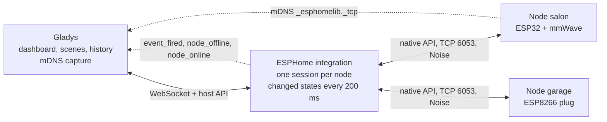
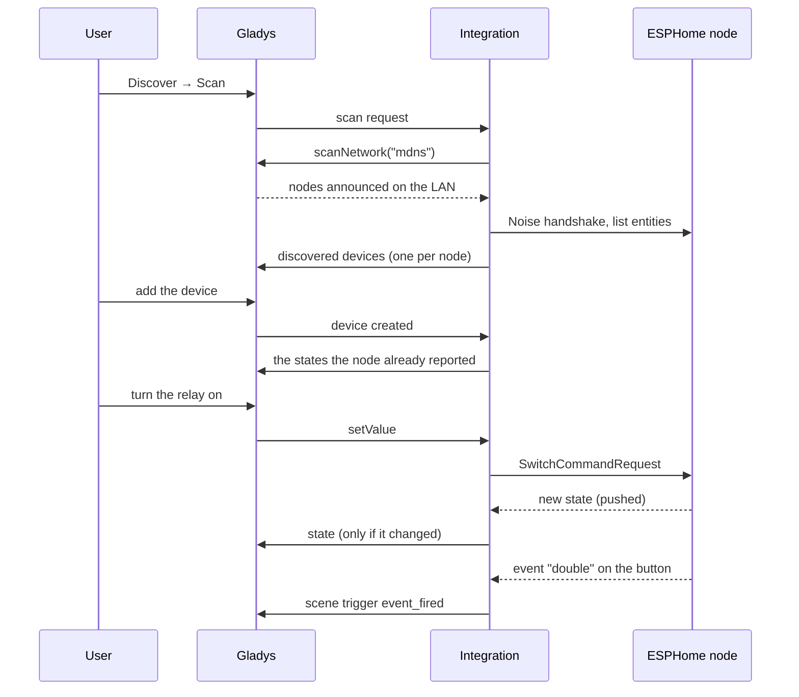
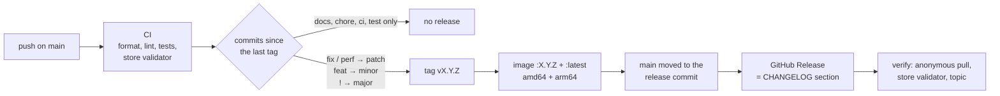

**English** · [Français](README.fr.md) · [Deutsch](README.de.md) · [Español](README.es.md)

# gladys-esphome

[](LICENSE)
[](https://github.com/William-De71/gladys-esphome/releases)
[](https://github.com/William-De71/gladys-esphome/actions/workflows/release.yml)
[](https://gladysassistant.com)


External [Gladys Assistant](https://gladysassistant.com) integration for **ESPHome** devices (ESP32 / ESP8266), over the local native API. Installed from the store in one click, it talks to your nodes directly on your local network (port 6053, Noise encryption): no cloud, no MQTT broker, no Home Assistant. Nodes are found by mDNS, their entities become Gladys features on their own, and every state change reaches Gladys the moment it happens.

📖 User documentation: [English](docs/en.md) — [Français](docs/fr.md) — [Deutsch](docs/de.md) — [Español](docs/es.md)

## Features

- **Automatic discovery**: Gladys captures the mDNS announces of the nodes; nothing to type, even when a DHCP lease moves.
- **Every common entity**: sensors, binary sensors, switches, lights, covers, fans, locks, sirens, valves, buttons, numbers, texts and thermostats (table below).
- **Real time**: nodes push their changes over a session kept open; only the values that changed are sent to Gladys.
- **Scenes**: start a scene when an ESPHome `event` fires (a double click, a doorbell) or when a node goes offline, and run the actions declared in a node's YAML (`api: actions:`) from a scene.
- **Resilient**: a node that was off when Gladys started, or that the scan missed, is reconnected on its own; the API slots of each node are spared.
- **Four languages**: English, French, German and Spanish, in Gladys and in the documentation.

## How it works




From the scan to a state, a command and a scene:



## Supported entities

| ESPHome entity  | Gladys support                                                             |
| --------------- | -------------------------------------------------------------------------- |
| `sensor`        | Numeric sensor, categorized by its `device_class` — or by its shape        |
| `binary_sensor` | Binary sensor (motion, presence, opening, leak, smoke…), by `device_class` |
| `text_sensor`   | Text feature (read-only)                                                   |
| `text`          | Writable text: send a message to a node (an e-paper or OLED `display:`)    |
| `switch`        | Binary switch                                                              |
| `light`         | On/off, brightness, color, color temperature — as the color modes allow    |
| `cover`         | State (open/close/stop) + position; curtain or shutter by `device_class`   |
| `fan`           | On/off + speed, scaled against the levels the firmware declares            |
| `lock`          | Lock / unlock; jammed and moving states are not reported as "unlocked"     |
| `siren`         | On / off                                                                   |
| `valve`         | Open / closed                                                              |
| `button`        | Push                                                                       |
| `number`        | Writable value bounded by the YAML `min_value` / `max_value`               |
| `climate`       | Target temperature (single setpoint) + current temperature                 |
| `event`         | No feature: the scene trigger "ESPHome event"                              |

Entity types with no Gladys equivalent (`media_player`, `camera`, `select`, `date`, …) are left out of discovery rather than mapped to something that could not work. An `energy` sensor in kWh or Wh is a cumulative index: Gladys derives the consumption and its cost from it.

### From YAML to Gladys


ESPHome has no device catalog: a node exposes whatever its YAML declares. The mapping therefore keys on what the firmware reports, in three passes:

1. the **`device_class`** (the Home Assistant vocabulary ESPHome documents) — `temperature`, `power`, `motion`, `door`…;
2. for a sensor declaring none, the **shape of its declaration** — a `°` unit is an angle, a unitless whole number a counter. This is what types the target angles and counters of mmWave sensors (`ld2410`, `ld2450`), which ESPHome never gives a class;
3. anything still unidentified becomes a **generic measurement**, shown under its own name and unit. It is never dropped.

Every category/type pair the mapping can emit is pinned by a test against the pairs the Gladys front knows, so no feature renders with an empty label.

## Configuration

| Field                  | Default | Use                                                                                  |
| ---------------------- | ------- | ------------------------------------------------------------------------------------ |
| Encryption key         | empty   | The `api: encryption: key:` shared by your nodes; empty for unencrypted nodes        |
| Keys per node          | empty   | `node\|key`, one per line, for the nodes with a key of their own                     |
| Nodes added by hand    | empty   | `salon.local`, `192.168.1.42` or `192.168.1.42:6053`, for a node the scan cannot see |
| Discovery duration (s) | 8       | How long the mDNS scan listens (3 to 30)                                             |
| Connection timeout (s) | 10      | How long to wait for a node before giving up on it (5 to 60)                         |

Actions of the integration page: **Test the connection** (a full discovery, with the number of nodes and features) and **Reconnect the nodes** (closes and reopens every session, after a reflash or a key change).

## Transport

ESPHome is local only: the manifest declares `"transports": ["local"]`, and each device carries a transport badge — **local** while its node is connected, **unreachable** while it is not.

## Scenes

| Trigger                  | When                                                                                 | Filters                  | Variables                                   |
| ------------------------ | ------------------------------------------------------------------------------------ | ------------------------ | ------------------------------------------- |
| ESPHome event            | An `event` entity fires (`single`, `double`, `long`…)                                | node, entity, event type | `node`, `entity`, `entity_id`, `event_type` |
| ESPHome node offline     | A node stayed disconnected for one minute (a reboot or an OTA update does not count) | node                     | `node`, `address`                           |
| ESPHome node back online | That node is connected again                                                         | node                     | `node`, `address`, `offline_minutes`        |

| Action                | Fields                                                     | Outputs          |
| --------------------- | ---------------------------------------------------------- | ---------------- |
| Run an ESPHome action | node, action, arguments (a JSON object, variables allowed) | `node`, `action` |

A button that tells single and double clicks apart, then an action Gladys can call:

```yaml
event:
  - platform: template
    name: 'Button'
    id: button_event
    event_types: [single, double]

binary_sensor:
  - platform: gpio
    pin: GPIO0
    on_multi_click:
      - timing:
          [ON for at most 0.5s, OFF for at most 0.3s, ON for at most 0.5s, OFF for at least 0.2s]
        then:
          - event.trigger: { id: button_event, event_type: double }
      - timing: [ON for at most 0.5s, OFF for at least 0.4s]
        then:
          - event.trigger: { id: button_event, event_type: single }

api:
  actions:
    - action: play_rtttl
      variables:
        song_str: string
      then:
        - rtttl.play:
            rtttl: !lambda 'return song_str;'
```

In a scene: trigger **ESPHome event** with node `salon`, entity `Button`, event type `double`; action **Run an ESPHome action** with node `salon`, action `play_rtttl`, arguments `{"song_str": "two_short:d=4,o=5,b=100:16e6,16e6"}`. For two seconds after the integration runs an action on a node, the events of that node do not start scenes: an action that fires an event cannot loop on the scene that called it.

## Installation

1. In Gladys (5.1.0 or newer): **Integrations → Store**, search for **ESPHome**, install.
2. Paste your encryption key in the configuration, save.
3. **Discover → Scan**, then add the nodes you want.

The [user documentation](docs/en.md) details the keys per node, the nodes added by hand, the `device_class` and the troubleshooting.

## Development

```bash
npm install
GLADYS_HOST_API_URL="http://localhost:1443" \
GLADYS_INTEGRATION_TOKEN="<token>" \
npm start
```

```
index.js                     SDK wiring only: createApp(new GladysIntegration()) + connect
src/
  app.js                     every handler (discovery, commands, scenes, device created)
  events.js                  scene triggers: event_fired, node_offline, node_online
  config.js                  config normalization, per-node keys, manual nodes
  devices.js                 discovery, state batching, commands
  messages.js                user-facing messages, in en / fr / de / es
  esphome/
    EsphomeManager.js        one live connection per node, entity index, last states
    actions.js               user-defined actions: typed arguments
    mapping.js               ESPHome entity -> Gladys feature descriptors
    convert.js               value translation, both directions
    constants.js             mDNS service, port, timings, external-id scheme
```

The platform id is the ESPHome **node name**, stable across reboots and DHCP leases — an IP address is not, so it lives in a device param instead:

```
device : ext:<selector>:esphome:<nodeName>
feature: ext:<selector>:esphome:<nodeName>:<entityType>-<objectId>:<featureKey>
```

**Push, not poll.** States reach Gladys from the node session, and no feature declares a `poll_frequency`. A watchdog retries, every minute, the known nodes that have no live session.

**Absent means default.** protobuf 3 never serializes a field holding its default value: a switch turned off, a plug drawing 0 W or a closed cover arrive with the field missing. Every event is completed from the entity schema before it is read.

**A node has four API slots.** Connection attempts to one node are shared, construction retries are capped at one, a node found by the scan _and_ declared by hand keeps a single session, and every session is closed gracefully on shutdown.

**States are batched, then deduplicated.** States are collected for 200 ms and published with `publishChangedStates`: a reading that did not change is dropped (sent again once an hour), but a binary state keeps its 0 → 1 → 0 transitions, so a movement shorter than the window still triggers a scene.

## Tests

```bash
npm test               # node --test, never touches the network
npm run lint           # ESLint
npm run format:check   # Prettier, as the CI runs it
npx github:GladysAssistant/integration-store . --skip-image-check
```

`test/structure.test.js` compares the discovery with `test/fixtures/discovery.baseline.json`, generated from v1.1.0 with a node exposing every entity shape: an external id, a category, a type, a unit or a bound that changes would force users to recreate their devices. `test/app.test.js` drives the handlers with the fake Gladys of the SDK.

## Release

Releases are automatic. Every push on `main` runs the CI, then computes the next version from the Conventional Commits since the last tag:



The manifest only reaches `main` once its image exists, so the store never announces a version it cannot pull. `CHANGELOG.md` is generated: never edit it by hand. **Actions → Release → Run workflow** offers `release-as` (force a version) and `dry-run` (show the version and the notes without publishing).

Commit and pull request titles follow [Conventional Commits](https://www.conventionalcommits.org/), in English, written as the changelog line the user will read: `feat(scenes): start a scene when an ESPHome node goes offline`.

## Troubleshooting

| Symptom                                          | Likely cause                                                                                    |
| ------------------------------------------------ | ----------------------------------------------------------------------------------------------- |
| No node found                                    | mDNS blocked (VLAN, client isolation): add the node by hand                                     |
| Node seen on the network but not in the list     | Encryption key mismatch: check `api: encryption: key:`, or use **Keys per node**                |
| Device "unreachable"                             | Node off, out of Wi-Fi range, or its four API slots taken (Home Assistant, an open log console) |
| A sensor under "Unknown"                         | No `device_class` in the YAML: add one and scan again                                           |
| The scene action fails with "declares no action" | Action name different from `action:` in the YAML; the error lists the actions the node declares |

Logs: the **Supervision** tab of the integration; add `DEBUG=gladys-integration-sdk` to the container for the SDK details.

## Contributing

Issues and pull requests are welcome: [bug report](https://github.com/William-De71/gladys-esphome/issues/new?template=bug_report.yml) (Gladys, integration and ESPHome versions, the YAML of the entity, logs) or [feature request](https://github.com/William-De71/gladys-esphome/issues/new?template=feature_request.yml). Feedback and questions also go to the [forum thread](https://community.gladysassistant.com/t/8494). Security problems: see [SECURITY.md](SECURITY.md).

Speaks the ESPHome native API through [`esphome-client`](https://github.com/hjdhjd/esphome-client), a zero-dependency implementation including the Noise handshake. Built on the [Gladys integration SDK](https://github.com/GladysAssistant/integration-sdk-js), from the [official template](https://github.com/GladysAssistant/integration-template-js).

## License

[Apache-2.0](LICENSE) — see also [NOTICE](NOTICE). ESPHome is a trademark of the Open Home Foundation; this project is not affiliated with it.
