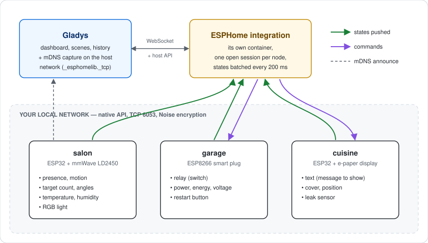
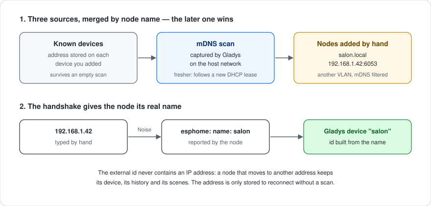

# gladys-esphome

Gladys Assistant external integration for **ESPHome** devices (ESP32 / ESP8266), over the local native API.


Installable in one click from [Gladys Assistant](https://gladysassistant.com), it talks to your nodes directly on your local network, through the ESPHome native API (port 6053, Noise encryption) — no cloud, no MQTT broker, no Home Assistant. Nodes are found by mDNS, their entities become Gladys features on their own, and every state change is pushed to Gladys the moment it happens.

📖 User documentation: [English](docs/en.md) — [Français](docs/fr.md) — [Deutsch](docs/de.md) — [Español](docs/es.md)

## How it works



| ESPHome entity  | Gladys support                                                             |
| --------------- | -------------------------------------------------------------------------- |
| `sensor`        | Numeric sensor, categorized by its `device_class` — or by its shape        |
| `binary_sensor` | Binary sensor (motion, presence, opening, leak, smoke…), by `device_class` |
| `text_sensor`   | Text feature (read-only)                                                   |
| `text`          | Writable text: send a message to a node (an e-paper or OLED `display:`)    |
| `switch`        | Binary switch                                                              |
| `light`         | On/off, brightness, color, color temperature — as the color modes allow    |
| `cover`         | State (open/close/stop) + position; curtain or shutter by `device_class`   |
| `fan`           | On/off + speed, scaled against the levels the firmware declares            |
| `lock`          | Lock / unlock; jammed and moving states are not reported as "unlocked"     |
| `siren`         | On / off                                                                   |
| `valve`         | Open / closed                                                              |
| `button`        | Push                                                                       |
| `number`        | Writable value bounded by the YAML `min_value` / `max_value`               |
| `climate`       | Target temperature (single setpoint) + current temperature                 |

Entity types with no Gladys equivalent (`media_player`, `camera`, `select`, `event`, `date`, …) are left out of discovery rather than mapped to something that could not work.

## From YAML to Gladys


ESPHome has no device catalog: a node exposes whatever its YAML declares. The mapping therefore keys on what the firmware reports, in three passes:

1. the **`device_class`** (the Home Assistant vocabulary ESPHome documents) — `temperature`, `power`, `motion`, `door`…;
2. for a sensor declaring none, the **shape of its declaration** — a `°` unit is an angle, a unitless whole number a counter. This is what types the target angles and counters of mmWave sensors (`ld2410`, `ld2450`), which ESPHome never gives a class;
3. anything still unidentified becomes a **generic measurement**, shown under its own name and unit. It is never dropped.

Every category/type pair the mapping can emit is pinned by a test against the pairs the Gladys front knows, so no feature renders with an empty label.

## Discovery



Integration containers run on a bridge network and never receive mDNS traffic. The manifest declares the capture, Gladys performs it on the host network, and the integration joins the nodes over unicast, which crosses the NAT:

```json
"network_discovery": [{ "type": "mdns", "service": "_esphomelib._tcp" }]
```

The scan is merged with the addresses stored on the devices already created (so an empty scan never makes a node vanish) and with the nodes declared by hand (for another VLAN, or a router filtering multicast).

## External-id scheme

The platform id is the ESPHome **node name**, stable across reboots and DHCP leases — an IP address is not, so it lives in a device param instead.

```
device : ext:<selector>:esphome:<nodeName>
feature: ext:<selector>:esphome:<nodeName>:<entityType>-<objectId>:<featureKey>
```

The middle segment is the `esphome-client` branded entity id, so a feature received back from Gladys maps to an entity without a lookup table. Parsing splits from the **right**, since both the node name and the object id may contain dashes.

## Architecture

```
index.js                     SDK wiring: handlers, manifest actions, watchdog
src/
  config.js                  config normalization, per-node keys, manual nodes
  devices.js                 discovery, state batching, commands
  messages.js                user-facing messages, in en / fr / de / es
  esphome/
    EsphomeManager.js        one live connection per node, entity key index
    mapping.js               ESPHome entity -> Gladys feature descriptors
    convert.js               value translation, both directions
    constants.js             mDNS service, port, timings, external-id scheme
```

## Design notes

**Push, not poll.** ESPHome nodes push their state changes over a session kept open, so states reach Gladys from the manager's callback and no feature declares a `poll_frequency`. A watchdog retries, every minute, the known nodes that have no live session — the client library reconnects a session it once had, but never one that failed outright (a node powered off when the container started).

**Absent means default.** protobuf 3 never serializes a field holding its default value: a switch turned off, a plug drawing 0 W, a closed cover or a pure blue light (red = 0) arrive with the field missing. A state response is a full snapshot, so every event is completed from the entity schema before it is read; the genuine "no reading" signals are `missing_state` and NaN, which publish nothing.

**A node has four API slots.** The default firmware accepts four simultaneous API clients. Connection attempts to one node are shared rather than duplicated, construction retries are capped at one, a node found by the scan _and_ declared by hand keeps a single session, and every session is closed gracefully on shutdown.

**States are batched.** A node pushes one event per entity, and an mmWave sensor tracking targets pushes dozens per second. States are collected for 200 ms and sent in one request, a measurement collapsing to its latest value — but a binary state keeps its 0 → 1 → 0 transitions, so a movement shorter than the window still triggers a scene.

**Encryption.** ESPHome uses the Noise protocol (`api: encryption: key:`). Keys are per node, so the configuration takes a default key plus per-node overrides. An empty key means a plaintext connection, which a node without an `encryption` block expects.

## Development

```bash
npm install
GLADYS_HOST_API_URL="http://localhost:1443" \
GLADYS_INTEGRATION_TOKEN="<token>" \
npm start
```

```bash
npm test          # node --test
npm run lint      # eslint
npm run format    # prettier
```

Releases are cut from GitHub: **Actions → Release → Run workflow**, then pick the bump. The workflow updates the version in `package.json` and the manifest (version **and** `docker_image` tag), regenerates `CHANGELOG.md` from the Conventional Commits, pushes the commit and the tag in one atomic push, publishes the GitHub release and builds the multi-arch image (amd64 + arm64), with the manifest shipped as an image label.

## Credits

Speaks the ESPHome native API through [`esphome-client`](https://github.com/hjdhjd/esphome-client), a zero-dependency implementation including the Noise handshake. Built on the [Gladys integration SDK](https://github.com/GladysAssistant/integration-sdk-js), from the [official template](https://github.com/GladysAssistant/integration-template-js).

## Repository topics

Set these as the repository topics on GitHub (**About → ⚙️ → Topics**), so the integration surfaces in the searches people actually run:

```
gladys  gladys-assistant  esphome  esp32  esp8266  home-automation  domotique  smart-home  iot  nodejs
```

The GitHub **About** description mirrors the first line of this README and the `description` field of `gladys-assistant-integration.json` — keep the three in sync when one changes.

## License

[Apache-2.0](LICENSE)
